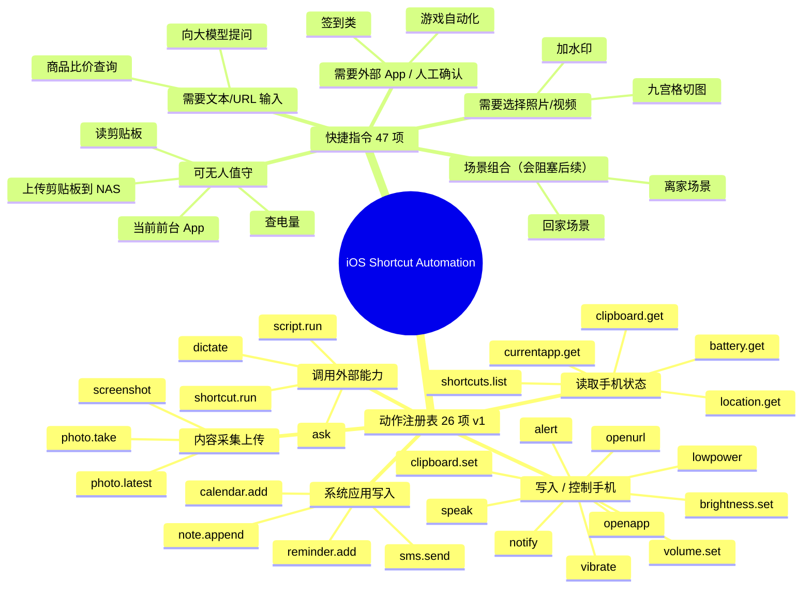

# iOS 快捷指令自动化 · 思维导图

版本：v1　动作：26　快捷指令分类：示例

> 由 `build/gen_mindmap.py` 自动生成，改数据请改 `actions.json` / `examples/shortcut-categories.example.json`。

## 总览图

## 一、动作注册表（26 项，服务端可调）

| 分类 | 动作 | 说明 | 参数 |
|---|---|---|---|
| 读取手机状态 | `clipboard.get` | 读手机剪贴板 | — |
| 读取手机状态 | `battery.get` | 读电量 | — |
| 读取手机状态 | `currentapp.get` | 当前前台 App | — |
| 读取手机状态 | `location.get` | 当前位置 | — |
| 读取手机状态 | `shortcuts.list` | 列出手机全部快捷指令名 | — |
| 写入 / 控制手机 | `clipboard.set` | 写手机剪贴板 | text |
| 写入 / 控制手机 | `notify` | 弹手机通知 | title, body |
| 写入 / 控制手机 | `speak` | 手机朗读 | text |
| 写入 / 控制手机 | `vibrate` | 手机振动 | — |
| 写入 / 控制手机 | `alert` | 弹对话框 | title, message |
| 写入 / 控制手机 | `brightness.set` | 设亮度 | level |
| 写入 / 控制手机 | `volume.set` | 设媒体音量 | level |
| 写入 / 控制手机 | `lowpower` | 低电量模式。mode=on/off/set/toggle（默认 toggle）。 | mode |
| 写入 / 控制手机 | `openurl` | 打开链接 / App scheme（会打断后续动作，回执在它之前发） | url |
| 写入 / 控制手机 | `openapp` | 打开 App | name |
| 内容采集上传 | `photo.latest` | 取最新照片 → 上传 NAS | — |
| 内容采集上传 | `photo.take` | 拍照 → 上传 NAS | — |
| 内容采集上传 | `screenshot` | 截图 → 上传 NAS | — |
| 系统应用写入 | `reminder.add` | 建提醒（列表「任务」）。不支持截止时间：服务端已撤掉 due（WFAlertCustomTime 只吃相对偏移，ISO 落地不了，详见 build/README）。 | title, notes, list |
| 系统应用写入 | `calendar.add` | 建日程 | title, start, end, location, notes |
| 系统应用写入 | `note.append` | 追加到备忘录。entity=目标备忘录名，text=追加内容。 | note, text |
| 系统应用写入 | `sms.send` | 发短信/iMessage | to, text |
| 调用外部能力 | `shortcut.run` | 触发任意快捷指令（名字驱动，支持中文/URL 编码） | name, input |
| 调用外部能力 | `script.run` | 跑 Scriptable 里的 JS 脚本 | name |
| 调用外部能力 | `dictate` | 语音输入转文字 | — |
| 调用外部能力 | `ask` | 弹框问输入 | inputType |

## 二、快捷指令分类（47 项）

### 可无人值守（4 个）

> 纯自动化可跑，无需人工介入。可放入批处理与定时任务。

| 名称 |
|---|
| 读剪贴板 |
| 查电量 |
| 当前前台 App |
| 上传剪贴板到 NAS |

### 需要文本/URL 输入（2 个）

> 调用时必须提供 input 参数，否则卡在输入框直到超时。

| 名称 |
|---|
| 向大模型提问 |
| 商品比价查询 |

### 需要选择照片/视频（2 个）

> 调用后弹出相册选择器，必须人工选素材。

| 名称 |
|---|
| 加水印 |
| 九宫格切图 |

### 需要外部 App / 人工确认（2 个）

> 会切走前台 App 或需要点击确认，后台执行会中断。

| 名称 |
|---|
| 签到类 |
| 游戏自动化 |

### 场景组合（会阻塞后续）（2 个）

> 内部含多步交互，实测会挂起整条派发链，禁止放进批量列表。

| 名称 |
|---|
| 离家场景 |
| 回家场景 |

